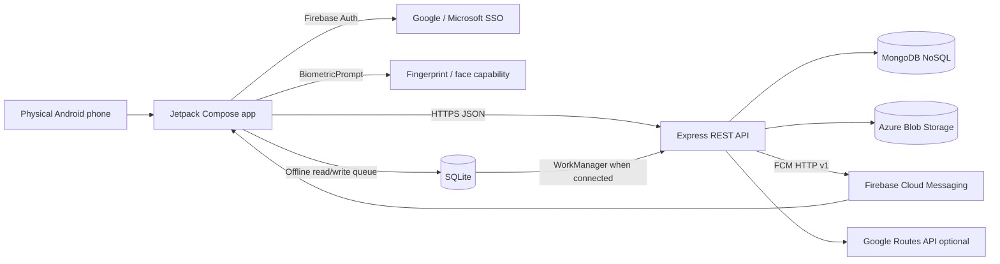

# Stellar Fuel Monitor


**PROG7314 Final Portfolio of Evidence · Android 3.0-final-poe · version code 3**

Stellar helps a fleet manager answer a practical question: which fuel result needs investigation, and what explains it? Select an operating date on Home, open a vehicle and inspect its completed fuel cycles, trip context and benchmark. When a result needs follow-up, review the alert, put the registration on the shared Fleet Watchlist or attach supporting evidence. A low km/L figure prompts investigation. Vehicle, load, route and data quality affect its interpretation.

## Final assessment evidence

| Evidence | Owner | Link or result to enter after verification |
|---|---|---|
| Narrated demonstration | Jival | [POE DEMO VIDEO](https://drive.google.com/file/d/1G54iZpUpv4ySkrfGczObMD6ulrR_gDoc/view?pli=1). Confirm it plays without sign-in and add feature timestamps in the evidence index. |
| Application screenshots | Josh and Jival | 22 phone screenshots (6 Nov 2026, 20:39–20:40) from debug build `3.0-final-poe-debug (3)` against `http://192.168.68.120:3000/api/`. Phone: Samsung Galaxy A26 (Android version still to be added). Evidence Vault and Watchlist are empty, SSO is not shown and the Administration screen reports Azure Blob and Firebase push as “No”. |
| GitHub Actions | Nick | Deploy API to Azure [run #1](https://github.com/EMGPSD/prog7314-g4-2026-prog7314-poe-giggle-gang/actions/runs/42216625344) (commit `42bbc18`, success, 11 s) and run #2 (commit `40abed9`, success, 13 s) on 6 Nov 2026. Azure deploy was skipped (no `AZURE_WEBAPP_NAME` or publish profile). No run of Stellar Final POE CI was supplied, so the Android job and test counts are pending. |
| Cloud and database | Nick | The phone’s Administration screen shows MongoDB connected (`stellar_fuel_monitoring`, 161 trucks) on the local API. Hosted HTTPS health, a matched Azure blob (the screen shows local fallback) and a phone push receipt (shown as “No”) are pending. |

Use the [evidence checklist](docs/FINAL_POE_EVIDENCE_MATRIX.md) to connect each item to a criterion. When the owners supply final results, reconcile the tested commit, build and outcomes in this README, the release notes and the editable technical report.

## Earlier marks and Part 3 improvements

We received 84/100 (84%) for Formative 1 Part 1 and 81/100 (81%) for Formative 2 Part 2. We received numerical marks only, with no detailed written feedback or specific recommendations for improvement. We therefore independently reviewed the official Final POE marking rubric [1, pp. 21–23] and used its criteria to choose our Part 3 improvements.

We added biometric unlock after sign-in, cached records on the phone and queued alert edits for automatic synchronisation when connectivity returns. We added Firebase push notifications and English, Afrikaans and isiZulu support for navigation and common actions. Evidence Vault lets a reviewer attach a file to a vehicle investigation, while Fleet Watchlist gives the team a shared list of vehicles needing follow-up.

We extended the backend and API to handle evidence files, watchlist entries and device registrations. We expanded automated tests and GitHub Actions checks, updated navigation to expose the new features, prepared the Play Store listing and privacy documents, and revised the technical documentation and assessment evidence checklist. [Release notes](RELEASE_NOTES_FINAL_POE.md) · [Assessment evidence checklist](docs/FINAL_POE_EVIDENCE_MATRIX.md)

## From a fuel record to an investigation

The API measures completed fill-to-fill cycles and compares eligible cycles with historical performance. A data-quality warning is kept separate from a performance alert. The final version excludes warning cycles from the headline fleet average. On the phone, Home, Vehicles, Trips and Alerts lead into the underlying records. More contains reports, fuel records, the weight-aware fuel estimate, settings and investigation tools.

**Evidence Vault, user-defined feature 4.** Pick a JPEG, PNG, WebP or PDF, choose a known registration and optionally enter a trip ID and note. The client sends the file to the API in a JSON request. The server limits decoded files to 5 MiB, writes the bytes to Azure Blob Storage when configured and saves the file metadata in MongoDB. The saved entry links an investigation to its supporting document.

**Fleet Watchlist, user-defined feature 5.** Add a registration, assign Monitor, Priority or Critical and enter a follow-up note. The shared list has one entry per registration. On retrieval, the API adds the current km/L, rating and open-alert count so the reviewer can decide which vehicle to inspect first. Changing a watchlist priority has a separate purpose from changing an alert’s review status.

## Architecture and API integration



| Component | Responsibility and implementation |
|---|---|
| Native Android client | Kotlin and Jetpack Compose display the fleet information. Retrofit and OkHttp request JSON from the configured API. The Android app never needs cloud database or blob credentials. |
| Identity and preferences | Google Credential Manager and Microsoft OAuth feed Firebase Authentication [2], [3]. AndroidX requests a strong biometric after sign-in when enabled [4]. DataStore retains language, display, notification and biometric preferences [5]. |
| Local storage and replay | SQLite stores selected JSON responses and pending alert updates. WorkManager schedules a single connected-network job that replays queued updates [6]. |
| Express and MongoDB | The Node.js API calculates benchmarks, projects alerts and reads or writes records such as `alert_reviews`, `watchlist` and `evidence_records` through the MongoDB driver [7]. |
| Attachments and push | Azure stores file bytes using a server-held container SAS [8], [9]. Firebase Cloud Messaging registers devices and carries notifications sent by the backend [10], [14]. An optional Google Routes lookup compares an origin and destination for a road-distance estimate. |

| App or API operation | API contract | Expected behaviour |
|---|---|---|
| Open a date or vehicle | `GET /api/dashboard/summary`, `GET /api/analytics/vehicles/{reg}` | Fleet summary or a vehicle’s historical performance |
| Review an alert | `PATCH /api/alerts/{id}` with status and comment | Updated review, or a queued local edit after a network or server failure |
| Add evidence | `POST /api/evidence` and `GET /api/evidence` | Upload metadata returned with HTTP 201, then a filtered list by registration or trip |
| Manage the watchlist | `POST /api/watchlist`, `GET /api/watchlist`, `DELETE /api/watchlist/{registration}` | Add or update one registration, read the enriched list, or remove the entry |
| Enable or test notifications | `POST /api/notifications/register`, `/unregister` and `/test` under the same prefix | Token registration, removal request or device-targeted test send |
| Retrieve or remove an evidence file | `GET /api/evidence/:id/file` and `DELETE /api/evidence/:id` | The API streams stored bytes or removes the blob and metadata. Upload validates the actual file signature and records a SHA-256 checksum. |
| Inspect service status | `GET /api/health` | Connection and configuration indicators. Match these to an actual database change, blob object and received push for deployment evidence. |

### Behaviour at the device boundary

- **Biometrics.** The preference defaults to enabled. On a capable phone, a cancelled prompt leaves the gate visible for retry or sign-out. The screen offers continuation when strong biometrics are unavailable. Firebase identifies the signed-in user. The Android API client supplies no bearer token, while selected Express writes can require a separate legacy JWT when `AUTH_REQUIRED` is enabled. Confirm the deployed API access controls with the backend owner.
- **Offline work.** Previously loaded data can be read from SQLite when a live request fails. A supported alert status/comment edit is saved locally on I/O failure or HTTP 5xx. The UI displays the queued edit immediately. The worker attempts older edits first when connected, retries transient failures, removes successful edits and drops a permanently rejected edit. Evidence uploads and Watchlist changes require a working API connection.
- **Notifications.** Settings handles Android 13+ display permission and offers a test push. After saving an alert review, the API can broadcast to registered devices. The review can succeed even if delivery fails. The notification may show the comment, vehicle registration and status.
- **Languages.** English, Afrikaans and isiZulu are selected at runtime. A Kotlin translation map covers navigation, actions and common labels. Unmapped strings use their English text and fleet records retain their source values.
- **Logging.** Android Log records lifecycle, authentication, network, queue and sync events. Debug HTTP logging is BASIC and the release HTTP interceptor uses NONE. Some other logs contain account or record IDs. Redact them before sharing evidence.

### Firebase configuration and delivery

The FCM HTTP v1 sender reads either raw service-account JSON or its Base64 representation from the server host. Use one private setting, `FIREBASE_SERVICE_ACCOUNT_JSON` or `FIREBASE_SERVICE_ACCOUNT_BASE64`. Registration validates the token, device ID and Android platform. The test endpoint is rate-limited and reports sent and failed counts. The server attempts to remove registrations that FCM identifies as permanently invalid. The Android client and sender must use the same Firebase project. Nick’s register reports `auth/configuration-not-found` for Firebase Authentication in the intended project, `prog7314-poe-giggle-gang`. Matteo and Nick still need to confirm provider setup and demonstrate sign-in and push receipt on the same phone. [Firebase handover](docs/NICK_FCM_DEPLOYMENT_HANDOFF.md)

## Run the project

Use Node.js 22 for parity with CI, JDK 17, Android SDK 35 and Gradle 8.10.2. Open `android-app/` in Android Studio. For a first setup, copy the example property files and supply the environment-specific values in [the project setup guide](FINAL_POE_SETUP.md). Preserve existing local configuration.

From the application directory’s `server/` folder, install the locked dependencies and run the checks:

```powershell
npm ci
npm run check
npm test
npm run verify:analytics -- --quiet
npm start
```

On the phone set `STELLAR_API_BASE_URL` to the reachable HTTPS service ending in `/api/`. Set the Android Firebase project/app values, messaging sender ID and Google web client ID. Register the app’s signing fingerprints with the enabled providers. Set the MongoDB, FCM service account and Azure container configuration on the backend. Use `BLOB_ALLOW_LOCAL_FALLBACK=false` for cloud upload evidence. The release manifest disables cleartext traffic and Android backup. The debug manifest allows development HTTP.

From `android-app/`, using the Gradle version above:

```powershell
gradle :app:testDebugUnitTest :app:assembleDebug
```

Select a physical phone in Android Studio. For the assessed release record the installed version, device model and Android version, then use [the device checklist](docs/FINAL_POE_PHYSICAL_DEVICE_QA.md). The packaged server can serve cached fleet data and local state when MongoDB is unavailable. Check the selected data source before recording a cloud demonstration.

## Automated testing and release

The [GitHub Actions workflow](../.github/workflows/ci.yml) responds to pushes, pull requests and manual runs [11]. Repository checks inspect the expected files, forbidden artefacts and Android logging. After those checks, the Android job runs JVM tests and assembles a debug APK. The server job installs the lockfile, checks server JavaScript syntax, runs Node tests and verifies packaged analytics. Android tests cover calculations, settings, localisation, data models and the API contract. The server also tests evidence file signatures, invalid tokens and request validation. The server tests cover fuel-cycle benchmarks and warnings, alert severity, route estimates, role middleware and unavailable cloud-service configuration.

**GitHub snapshot reviewed** · `40abed9c49c7814dd59a1665070015e6aa8f8762`

Nick’s [issue register](docs/NICK_ISSUES_AND_EVIDENCE.md) records **52/52 backend tests** locally and a successful analytics run. His [API smoke report](docs/NICK_API_TEST_REPORT.md) records **28/28 checks** using a local API connected to MongoDB Atlas and Azure Blob Storage. It records watchlist writes, an evidence-file round trip with a matching SHA-256, and FCM rejecting and pruning a deliberately fake token after authenticating the server. Nick still needs to identify the tested commit and confirm the results for the assessed release. The Deploy API to Azure workflow passed on `40abed9` without deploying. Hosted API operation, the CI workflow and receipt on a physical phone await separate evidence.

Julian’s earlier handover recorded 34/34 Node tests and 20/20 packaged analytics checks on a different archive. [Earlier test record](docs/LOCAL_VERIFICATION.md).

A `Final-POE`-prefixed tag enables the signed release job after the Android and server jobs succeed. Signing requires the team’s private keystore and release configuration, including an HTTPS API and privacy-policy URL. The job builds an APK and AAB. The assessed commit, green Actions run, tag and signed artefact links await the release owner. The brief requests an explicit final tag, regular contributor history, a physical-phone video, a signed production APK and promotional screenshots [1].

## Assessment documents

[Editable technical report](docs/PROG7314_Julian_ST10440539_Technical_Report.docx) · [Release notes](RELEASE_NOTES_FINAL_POE.md) · [AI use](AI_USAGE_FINAL_POE.md) · [IEEE references](docs/TECHNICAL_REFERENCES.md) · [Evidence matrix](docs/FINAL_POE_EVIDENCE_MATRIX.md) · [Play Store listing](play-store/listing.md) · [Privacy policy](play-store/privacy-policy.md) · [Data safety review](play-store/data-safety.md) · [Outstanding evidence and owners](FINAL_HANDOFF_SUMMARY.md)

The internal work split credits Matteo Damilano, Nickolas Kelly, Julian Lew Morrison, Jival Ganesh and Josh Cullen Holmes. The brief specifies four participants at most [1, p. 1]. Matteo is confirming the formal assessment roster with the lecturer.


------------------------------------------------------------------------

## Table of Contents

-   [Project Overview](#project-overview)
-   [Architecture](#architecture)
-   [Core Application Features](#core-application-features)
-   [Final POE Requirements and Implementation
    Status](#final-poe-requirements-and-implementation-status)
-   [Technology Stack](#technology-stack)
-   [Repository Structure](#repository-structure)
-   [Prerequisites](#prerequisites)
-   [Getting Started](#getting-started)
-   [Testing and Quality Assurance](#testing-and-quality-assurance)
-   [Build and Release](#build-and-release)
-   [Release Notes](#release-notes)
-   [Demonstration Video](#demonstration-video)
-   [Screenshots](#screenshots)
-   [Known Configuration
    Requirements](#known-configuration-requirements)
-   [Group Members](#group-members)
-   [Final Submission Checklist](#final-submission-checklist)

------------------------------------------------------------------------

## Project Overview

Stellar Fuel Monitor Mobile helps fleet management and operations users
monitor vehicle fuel performance, review trip information and
investigate unusual fuel-consumption results.

The application uses the Stellar fuel-analysis service to present
operational information in a native Android experience. Fuel
calculations, data retrieval and core business rules are handled by the
REST API rather than being duplicated in the mobile interface.

The Final POE builds on the Part 2 Kotlin application. It focuses on
completing and verifying the additional security, resilience,
notification, accessibility and release-readiness requirements.

## Architecture

``` text
┌──────────────────────────────────────────┐
│       Native Android Application         │
│       Kotlin + Jetpack Compose            │
│                                          │
│  Authentication • Settings • Dashboard  │
│  Vehicles • Trips • Alerts • Reports     │
│  Biometrics • Offline-capable workflows  │
└─────────────────────┬────────────────────┘
                      │ HTTPS / JSON
                      ▼
┌──────────────────────────────────────────┐
│          Express.js / Node.js API         │
│                                          │
│  Authentication and API endpoints        │
│  Validation • Fuel analytics • Alerts    │
│  Investigation workflows • Reporting     │
└─────────────────────┬────────────────────┘
                      │
                      ▼
┌──────────────────────────────────────────┐
│                MongoDB                   │
│       Operational and fuel records       │
└──────────────────────────────────────────┘

Supporting services:
- Firebase Authentication / OAuth providers
- Firebase Cloud Messaging (push notifications)
- Android Room database (offline persistence, where enabled)
- Azure Blob Storage (where configured by the API)
```

The Android client is responsible for user interaction, navigation,
local preferences, secure re-authentication and presentation. The API
remains responsible for central data access, validation and
fuel-analysis operations.

## Core Application Features

The native Android application includes the following screens and
workflows:

-   **Authentication:** Google and Microsoft SSO integration through the
    configured Firebase authentication project.
-   **Biometric verification:** fingerprint or face verification for
    returning users on supported devices.
-   **Dashboard:** fleet average fuel efficiency, completed trips,
    performance summaries and priority investigations.
-   **Vehicles:** fleet listing and vehicle-specific information.
-   **Vehicle details and fuel performance:** current and historical
    km/L performance, trends and supporting trip history.
-   **Trips:** trip records and trip investigation details.
-   **Destination comparison:** comparison of a vehicle's performance
    against relevant historical performance for a destination.
-   **Alerts:** fuel-performance and data-quality alerts, with
    investigation and status workflows.
-   **Reports and insights:** operational summaries and fuel-performance
    reporting.
-   **Fuel and oil records:** supporting source records used by the
    fuel-monitoring workflow.
-   **Settings and profile:** user preferences and account-related
    options.
-   **Administration/API status:** operational and service information
    exposed by the application.

The exact availability of cloud-dependent functions depends on the
relevant service credentials and deployment configuration.

## Final POE Requirements and Implementation Status

The table below distinguishes functionality observed during development
from items that still require final integration evidence or
assessment-device verification. Update the status labels after the group
completes its final tests.

  -----------------------------------------------------------------------
  Requirement             Current project         Final verification
                          position                required
  ----------------------- ----------------------- -----------------------
  Native Android          Kotlin / Jetpack        Confirm final build on
  application             Compose app builds and  assessment device.
                          launches.               

  SSO registration and    Google and Microsoft    Configure the group's
  login                   Firebase SSO flows are  Firebase project and
                          included in the         demonstrate successful
                          project.                registration/login.

  Biometric               Biometric verification  Demonstrate on the
  authentication          screen and device       physical assessment
                          verification flow are   phone and verify the
                          present; biometric      returning-user flow.
                          verification was passed 
                          during emulator         
                          testing.                

  Application settings    Persistent Android      Change settings,
                          DataStore preferences   restart the app and
                          are implemented for     demonstrate that values
                          dashboard period,       persist.
                          notifications, compact  
                          cards, data-quality     
                          warning visibility and  
                          language preference.    

  REST API and database   Android app connects to Demonstrate the hosted
                          the Express.js API;     HTTPS API and verify a
                          MongoDB is the intended real database-backed
                          connected database,     request.
                          with packaged cache     
                          fallback available in   
                          the project.            

  Offline mode and        Final POE requirement:  Verify the implemented
  synchronisation         local persistence       offline workflow
                          (RoomDB or SQLite) and  end-to-end; do not
                          synchronisation of      claim completion until
                          selected actions/data   offline action and
                          after reconnection.     successful resync are
                                                  demonstrated.

  Real-time push          Firebase Cloud          Configure Firebase
  notifications           Messaging is the        messaging, trigger a
                          required notification   real alert and
                          service.                demonstrate delivery on
                                                  the phone.

  Multi-language support  A language preference   Verify complete
                          is stored by the        user-interface
                          settings layer.         localisation in at
                                                  least two official
                                                  South African languages
                                                  (for example, English
                                                  and Afrikaans). A
                                                  stored preference alone
                                                  is not full
                                                  localisation.

  Production assets       Application icon and    Verify the final icon,
                          final visual assets     screenshots and release
                          must be prepared.       branding.

  Automated build and     GitHub Actions is       Confirm the latest
  tests                   intended to build the   workflow run is green
                          Android app and run     on the final commit.
                          Android/API tests on    
                          pushes and pull         
                          requests.               

  Google Play readiness   Final POE requires a    Generate and verify the
                          signed production APK   signed release APK and
                          and promotional         required store assets.
                          screenshots.            
  -----------------------------------------------------------------------

## Technology Stack

### Android application

-   Kotlin
-   Jetpack Compose
-   Android SDK
-   AndroidX / Android Jetpack libraries
-   Android DataStore for persistent preferences
-   Android biometric APIs for local biometric verification
-   RoomDB or SQLite for the offline data scope, where implemented
-   Firebase Authentication and Firebase Cloud Messaging, where
    configured

### Backend and data

-   Node.js
-   Express.js
-   REST API using JSON
-   MongoDB
-   Packaged cache fallback for supported local/test scenarios
-   Azure Blob Storage integration where configured

### Development and DevOps

-   Android Studio
-   Gradle
-   Git and GitHub
-   GitHub Actions
-   Node Package Manager (npm)
-   Postman for API verification

## Repository Structure

The following is a high-level guide; folder names may differ slightly if
the repository has been reorganised.

``` text
Stellar_Fuel_Monitor_Final_POE/
│
├── android-app/
│   ├── app/
│   │   └── src/
│   │       └── main/
│   ├── gradle/
│   ├── build.gradle.kts
│   ├── settings.gradle.kts
│   ├── local.properties.example
│   └── README.md
│
├── server/
│   ├── package.json
│   ├── package-lock.json
│   ├── .env.example
│   └── ...
│
├── legacy-angular-reference/
│   └── ...
│
├── docs/
│   └── ...
│
└── .github/
    └── workflows/
        └── ...
```

The `legacy-angular-reference/` folder is retained as a migration
reference. The native Kotlin Android application is the mobile
application for this submission.

## Prerequisites

-   Android Studio.
-   Android SDK Platform 35 (or the SDK platform required by the project
    configuration).
-   JDK 17, if required by the project's Gradle configuration.
-   Node.js and npm (use the version supported by the backend).
-   Git.
-   An Android emulator or physical Android device.

You will also need the group's Firebase configuration for live SSO and
Firebase services, and a reachable API/database environment for
connected-data testing.

## Getting Started

### 1. Run the REST API

Open a terminal in the repository's `server` directory.

``` powershell
cd server
Copy-Item .env.example .env
npm ci
npm test
npm start
```

If the project does not contain a `package-lock.json`, use `npm install`
instead of `npm ci`.

By default, the local API is expected to use port `3000`. Check the
server startup output for the actual listening address and port.

Test the health endpoint in a browser or Postman:

``` text
http://localhost:3000/api/health
```

The backend may use packaged fallback data when MongoDB is not
configured. A successful health response does not, by itself, prove that
MongoDB is connected. Check the health response and server logs for the
database connection state.

### 2. Configure the Android application

1.  Open the `android-app` directory in Android Studio.
2.  Copy `local.properties.example` to a new file named
    `local.properties`.
3.  Set the Android SDK path and API base URL.
4.  Add the Firebase values supplied by the group.
5.  Keep `local.properties`, service-account files and signing
    credentials out of source control.
6.  Select **File → Sync Project with Gradle Files**.

Example `local.properties` values:

``` properties
sdk.dir=C:/Users/YourUser/AppData/Local/Android/Sdk

# Android emulator:
STELLAR_API_BASE_URL=http://10.0.2.2:3000/api/

# Firebase values (obtain these from the group's Firebase project):
FIREBASE_API_KEY=
FIREBASE_APP_ID=
FIREBASE_PROJECT_ID=
FIREBASE_MESSAGING_SENDER_ID=
GOOGLE_WEB_CLIENT_ID=
```

Use the actual SDK location on your computer. Do not copy the example
Firebase values as real credentials.

### 3. Run on an emulator

For the Android emulator, `10.0.2.2` maps to the development computer's
localhost.

1.  Start the backend API.
2.  Start an Android emulator from Android Studio Device Manager.
3.  Select the `app` run configuration.
4.  Click **Run**.
5.  Sign in using a configured test account or use the local-preview
    option only where the build explicitly provides it for development.

### 4. Run on a physical Android device

The physical phone cannot use `10.0.2.2` to reach the computer's
localhost.

1.  Connect the phone and computer to the same Wi-Fi network.
2.  On Windows, run `ipconfig` and find the computer's Wi-Fi IPv4
    address.
3.  Set `STELLAR_API_BASE_URL` to the computer's LAN address:

``` properties
STELLAR_API_BASE_URL=http://192.168.1.50:3000/api/
```

Replace `192.168.1.50` with the actual IPv4 address.

4.  Ensure the backend is listening on an address accessible from the
    network (not only `127.0.0.1`).
5.  Allow the backend's port through Windows Firewall on the private
    network if prompted.
6.  Test `http://<PC-LAN-IP>:3000/api/health` in Chrome on the phone.
7.  Rebuild the APK and install the newly generated APK.

For production or external demonstrations, use a hosted **HTTPS** API
rather than a development computer's LAN address. Android release builds
should not rely on cleartext HTTP.

## Testing and Quality Assurance

### Android build

From Android Studio, use **Build → Make Project** or run:

``` powershell
.\gradlew.bat :app:assembleDebug
```

The debug APK is normally generated at:

``` text
android-app/app/build/outputs/apk/debug/app-debug.apk
```

### Backend tests

From the `server` directory:

``` powershell
npm test
```

The Part 2 conversion QA recorded nine packaged Node tests passing.
Re-run the current test suite and report the latest result rather than
assuming that historical results represent the final submission.

### API testing with Postman

Use Postman to verify the API endpoints used by the mobile application.
For alert testing, the current workflow is based on retrieving alerts
generated by the fuel-analysis logic and then updating an alert's
investigation status; it is not necessarily a manual `POST`
alert-creation workflow.

Example local base URL:

``` text
http://localhost:3000/api
```

Useful checks include:

-   `GET /health` --- API health and service state.
-   `GET /alerts` --- retrieve generated alerts.
-   `GET /vehicles` --- retrieve fleet records.
-   `GET /dashboard/summary` --- retrieve dashboard information.
-   `PATCH /alerts/:id` --- update an alert's status, where supported by
    the API.

Use the exact request body and response schema implemented by the
current server. Do not assume that every endpoint accepts the same
payload.

### Physical-device QA

The final test pass should include:

-   Fresh installation and application launch.
-   SSO registration and login.
-   Biometric verification for a returning user.
-   Settings changes and persistence after restart.
-   Dashboard, vehicle, trip, alert and report navigation.
-   API connectivity over the physical device's network.
-   Offline action and successful synchronisation after reconnecting.
-   Push-notification delivery.
-   At least two fully localised language experiences.
-   Error, loading, empty and retry states.
-   Final release build installation.

## Build and Release

### Debug APK

``` powershell
.\gradlew.bat :app:assembleDebug
```

Output:

``` text
app/build/outputs/apk/debug/app-debug.apk
```

### Signed production APK

The Final POE requires a signed production APK as evidence of Google
Play Store preparation.

1.  Create or obtain the group's release keystore.
2.  Keep the keystore and passwords outside Git.
3.  Configure the release signing properties locally or through secure
    CI secrets.
4.  In Android Studio, select **Build → Generate Signed Bundle / APK**.
5.  Choose **APK**, select the release build variant and complete
    signing.
6.  Install and test the signed APK on a physical Android device.
7.  Retain the signed APK as a submission artefact in the appropriate
    release location.

Never commit keystore files, signing passwords, Firebase service-account
keys or other secrets to the repository.

### GitHub Actions

The repository should use GitHub Actions to: - Build the Android
application on remote pushes and pull requests. - Run the Android
unit-test suite. - Install backend dependencies and run the Express API
test suite. - Report failures clearly so they can be fixed before
release.

Before submission, confirm that the workflow has passed on the exact
commit tagged as the Final POE release.

### Final release tag

After final testing and approval, tag the final deployment commit
clearly as the Final POE. For example:

``` bash
git tag -a "Final-POE" -m "Stellar Fuel Monitor Mobile - Final POE"
git push origin "Final-POE"
```

If the tag already exists, check the repository before creating or
replacing it.

## Release Notes

Use this section to record the functional changes made since the Part 2
submission. The entries below describe the known project direction and
observed changes; edit them to match the final merged code and verified
release.

### Final POE release --- \[insert release date/version\]

-   Continued the migration from the legacy Angular/Ionic interface to
    the native Kotlin and Jetpack Compose Android application.
-   Refined the native dashboard and mobile navigation for the Android
    phone experience.
-   Integrated the biometric verification step for returning-user
    access; verified the flow during emulator testing.
-   Continued integration and physical-device testing against the
    Express.js REST API.
-   Added or refined alert investigation testing, including retrieval of
    generated alerts and status updates through the API.
-   Completed additional build, installation and device-level QA.

**Add the following only once implemented and verified in the final
release:**

-   RoomDB/SQLite offline persistence and automatic synchronisation
    after reconnection.
-   Firebase Cloud Messaging push notifications for real-time
    fuel/anomaly alerts.
-   Complete localisation of the user interface in at least two official
    South African languages.
-   Final production application icon, promotional screenshots and
    signed release APK.

## Demonstration Video

**Final POE demonstration video:** https://drive.google.com/file/d/1G54iZpUpv4ySkrfGczObMD6ulrR_gDoc/view?usp=sharing\


## Group Members

  Member                Student number
  --------------------- ----------------
  Matteo Damilano       ST10434057
  Jival Ganesh          ST10442123
  Julian Lew Morrison   ST10440539
  Nickolas Kelly        ST10442063
  Josh Cullen Holmes    ST10322057

------------------------------------------------------------------------

**Module:** PROG7314 
**Project:** Stellar Fuel Monitor Mobile\
**Submission:** Final POE (Part 3)
