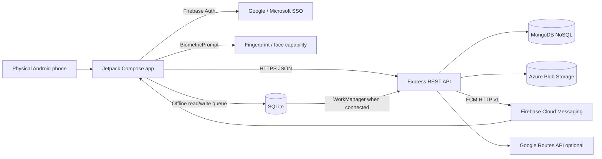

# Stellar Fuel Monitor — PROG7314 Final POE


A native Kotlin / Jetpack Compose Android application backed by the group's custom Express.js REST API, MongoDB persistence, Azure Blob Storage and Firebase services. This repository is the **Final POE** continuation of the Part 2 prototype.

> **Submission rule:** the assessment brief allows a maximum of four participants. The final ARC submission, repository contributors and cover information must reflect the lecturer-approved group of no more than four students. Historical Part 2 files may contain older contributor notes and should not be treated as the final group declaration.

## Final POE feature status

| Requirement | Final implementation | Evidence / entry point |
|---|---|---|
| Native Android app | Kotlin + Jetpack Compose | `android-app/` |
| SSO | Firebase Authentication: Google + Microsoft | `auth/AuthManager.kt`, login screen |
| Biometric authentication | AndroidX `BiometricPrompt`, strong biometric gate after SSO | `biometric/BiometricAuthenticator.kt` |
| Settings | Persistent DataStore preferences | Settings screen |
| Custom REST API + database | Express.js API + MongoDB, packaged cache fallback for local QA | `server/src/` |
| Offline mode + automatic sync | SQLite response cache + queued alert writes + WorkManager reconnect sync | `offline/` + Offline Sync screen |
| Real-time notifications | Firebase Cloud Messaging client + server-side FCM HTTP v1 sender | `notifications/`, `/api/notifications/*` |
| Multi-language | English, Afrikaans and isiZulu runtime localisation | `localization/AppLocalization.kt` |
| Blob storage | Azure Blob Storage evidence uploads + MongoDB metadata | Evidence Vault, `/api/evidence` |
| NoSQL read/write | MongoDB repository for settings, reviews, push tokens, evidence metadata and watchlist | `server/src/repository.js` |
| User-defined feature 4 | Evidence Vault | More → Evidence Vault |
| User-defined feature 5 | Fleet Watchlist / investigation prioritisation | More → Fleet Watchlist |
| Testing / CI | Android JVM tests + Node tests + repository QA on every push | `.github/workflows/ci.yml` |
| Release readiness | release signing config, signed APK/AAB CI job, store listing/privacy/data-safety drafts | `play-store/`, `docs/PLAY_STORE_READINESS.md` |
| Logging | Android lifecycle, API, authentication, biometric and sync logging | Android `Log` calls |

## Architecture



The mobile client handles secure user interaction, local state, offline resilience and presentation. The REST API remains responsible for the heavy fleet/fuel analytics, trip benchmarking, persistence, evidence metadata and push orchestration.

## User journeys

The bottom navigation provides **Home, Vehicles, Trips, Alerts and More**. More exposes Reports, Fuel Records, Fuel Estimate, Evidence Vault, Fleet Watchlist, Offline Sync, Administration, Settings and Profile. Vehicle and trip drill-downs preserve the Part 2 analytics, while the Final POE adds secure biometric entry, offline queueing, live FCM notifications and three-language UI support.

### User-defined feature 4 — Evidence Vault

A user can select JPEG, PNG, WEBP or PDF evidence, associate it with a fleet registration and optional trip, add a note, and upload it. Files are capped at 5 MB. The API stores file bytes in Azure Blob Storage and persists searchable metadata in MongoDB. Local file fallback exists only for developer QA and can be disabled with `BLOB_ALLOW_LOCAL_FALLBACK=false` so a cloud misconfiguration cannot be hidden during assessment.

### User-defined feature 5 — Fleet Watchlist

Users can add known registrations to a shared investigation watchlist, assign Monitor / Priority / Critical urgency, record notes, and see live km/L rating and open-alert context. Watchlist state is persisted through the custom API and MongoDB and can be removed from the app.

## Final POE setup

Read **`FINAL_POE_SETUP.md`** before building. Real credentials are deliberately excluded from source control.

### Android

```text
1. Open android-app/ in Android Studio.
2. Copy local.properties.example -> local.properties.
3. Set hosted HTTPS API + Firebase + Google OAuth values.
4. Sync Gradle.
5. Run unit tests.
6. Install on a physical Android phone.
```

### API

```powershell
cd server
Copy-Item .env.example .env
npm ci
npm test
npm start
```

For the assessed build use hosted MongoDB, a hosted HTTPS API, Azure Blob credentials, and Firebase service-account credentials. The server health endpoint exposes non-secret readiness indicators under `finalPoe` so the Administration screen can prove cloud-service configuration without revealing credentials.

## Automated testing and CI/CD

Every push and pull request runs:

1. repository structure / secret / Android logging checks;
2. Android JVM unit tests and a debug APK build;
3. Node syntax checks, automated API/analytics tests and packaged analytics verification.

A tag beginning with `Final-POE` additionally runs the signed release job, restores release configuration from **GitHub Secrets**, and builds both a signed production APK and AAB as workflow artefacts. No keystore or service-account secret is committed.

The Final POE rubric also rewards a strong commit history and multiple contributors. **Do not manufacture commits.** Preserve the group's real feature-by-feature history and merge work through normal commits / pull requests. Before submission, create an annotated final tag such as:

```bash
git tag -a Final-POE -m "Final POE"
git push origin Final-POE
```

## Demonstration video

**Final demonstration video:** _replace this line with the team's working unlisted YouTube/video URL before submission._

Use `docs/FINAL_POE_VIDEO_RUNBOOK.md`. The recording must be on a **physical Android phone** with voice-over and should visibly prove SSO, biometrics, settings, live REST data, offline queue + reconnection sync, FCM, cloud/database changes, Evidence Vault and Fleet Watchlist.

## Play Store readiness

Release signing, adaptive launcher assets, minification/resource shrinking, store copy, privacy draft, data-safety draft and screenshot requirements are prepared. The remaining evidence must be produced from the real release build: signed APK/AAB, Play Console material and screenshots captured on a physical device. See `docs/PLAY_STORE_READINESS.md` and `play-store/`.

## Repository documentation

- `FINAL_POE_SETUP.md` — complete service/configuration setup
- `RUBRIC_STATUS_FINAL_POE.md` — marks-oriented implementation/evidence matrix
- `RELEASE_NOTES_FINAL_POE.md` — changes since Part 2
- `AI_USAGE_FINAL_POE.md` — transparent AI usage disclosure
- `docs/FINAL_POE_PHYSICAL_DEVICE_QA.md` — pre-submission QA
- `docs/FINAL_POE_VIDEO_RUNBOOK.md` — exact video sequence
- `docs/FINAL_POE_EVIDENCE_MATRIX.md` — code-to-rubric evidence mapping
- `docs/PLAY_STORE_READINESS.md` — release/store checklist
- `docs/TECHNICAL_REFERENCES.md` — official implementation references
- `scripts/final-evidence-readiness.mjs` — final blocker check for video/privacy/screenshots

## Important pre-submission truth checks

This repository can provide the code and release configuration, but several rubric items require evidence that cannot be honestly fabricated in source code: a successful **physical-device run**, real Firebase/Azure/Mongo cloud credentials, a real FCM delivery, the group's actual Git history/contributors, a signed release generated with the group's private key, real Play Store screenshots, and the final voice-over video URL. Complete the checklists before ARC submission.
